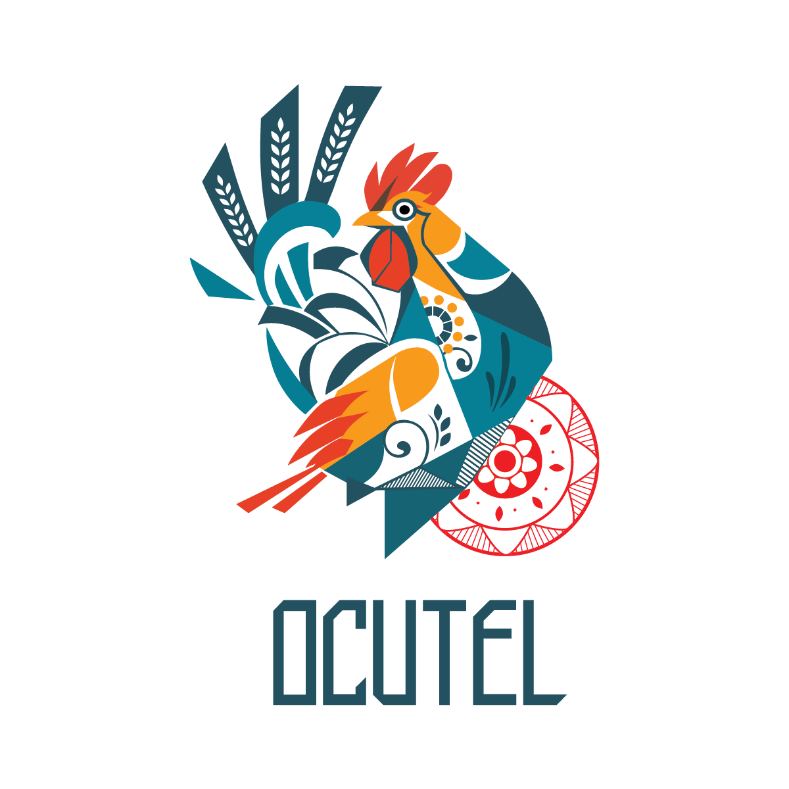

# Marca Ocutel

Entrega final da identidade visual recebida da empresa de marketing contratada, em 13 de outubro de 2026.

A pasta [`2026-10-13`](2026-10-13/) conserva os 65 ficheiros da entrega com os nomes e conteúdos originais:

- `PNG/`: 18 imagens para utilização digital.
- `SVG/`: 28 ficheiros vetoriais, incluindo variantes e cores.
- `EPS/`: 18 ficheiros vetoriais para produção gráfica.
- `Stationary/`: cartão de visita em PDF.

Origem: `TransferNow-202610133eOWoV1h.zip`. Foram excluídos apenas os dois ficheiros de metadados macOS `.DS_Store`.

## Pré-visualização

As diferentes variantes estão preservadas para escolha conforme o contexto de aplicação.
